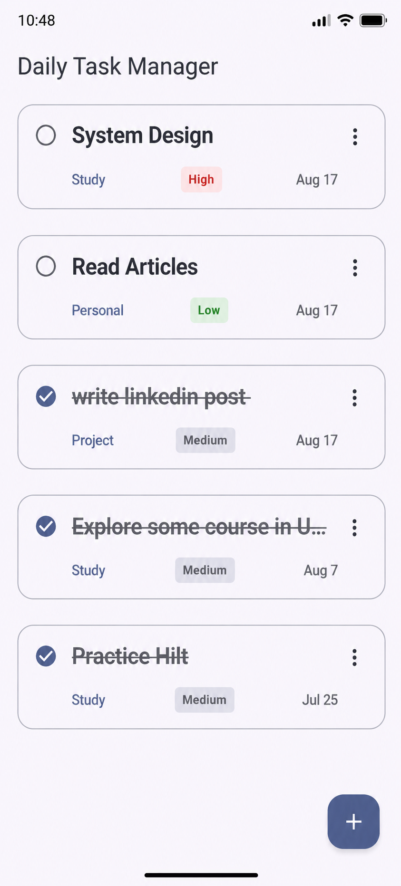
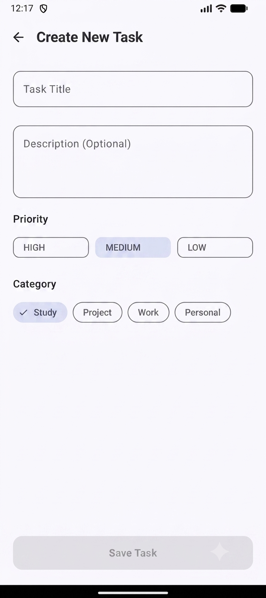

# 📋 DailyTaskManager

A modern **offline-first Android Task Management application** built using Kotlin, Jetpack Compose, MVVM, Hilt, Room, Kotlin Coroutines, and WorkManager.

The application supports local task management, backend integration, JWT authentication, user-specific task ownership, and background data synchronization.


---

## ✨ Key Features

- ✅ Modern UI built with Jetpack Compose and Material 3
- ✅ MVVM architecture
- ✅ Dependency Injection using Hilt
- ✅ Local persistence using Room Database
- ✅ REST API integration using Retrofit
- ✅ JWT-based user authentication
- ✅ User-specific task ownership and data isolation
- ✅ Offline-first architecture
- ✅ Background synchronization using WorkManager
- ✅ Network-aware synchronization
- ✅ Task synchronization status tracking
- ✅ Kotlin Coroutines and Flow
- ✅ Local and remote data management

---

## 📱 Features and Implementation

### 1. Authentication and User Management

- User authentication using JWT.
- Secure API communication using authentication tokens.
- Backend authentication and authorization using Express middleware.
- User-specific task ownership.
- Tasks are associated with their respective authenticated users.
- Backend prevents users from accessing other users' tasks.

### 2. Offline-First Architecture

The application follows a local-first approach where Room Database acts as the **Single Source of Truth** for the UI.

- Tasks are stored locally before being synchronized with the backend.
- Users can continue managing locally available tasks without an internet connection.
- Local changes are tracked using synchronization statuses.
- Remote data is merged while preserving local changes that are waiting to synchronize.

### 3. Data Synchronization

Implemented synchronization status tracking to manage local and remote task operations.

| Status | Purpose |
|---|---|
| `PENDING` | Newly created task waiting for synchronization |
| `PENDING_UPDATE` | Updated task waiting for synchronization |
| `SYNCED` | Task successfully synchronized with the backend |
| `FAILED` | Synchronization attempt failed |
| `DELETE_PENDING` | Task deletion waiting for synchronization |

Additional implementation details:

- Local IDs and server IDs are maintained separately.
- Pending operations are tracked to avoid unnecessary synchronization.
- Local changes are protected during remote data merging.
- Synchronization is processed sequentially.

### 4. Background Synchronization with WorkManager

WorkManager handles background synchronization.

- Network connectivity constraints.
- Automatic execution when synchronization conditions are met.
- Retry handling for temporary failures.
- Processing pending synchronization operations.
- Background synchronization without requiring users to manually trigger API requests.

### 5. Backend Integration

Integrated the Android application with a deployed REST API backend.

- User authentication and authorization.
- Task creation and retrieval.
- User-specific task ownership.
- Communication between Android and backend.
- JSON serialization and deserialization.
- API error handling.

**Backend URL:**

https://daily-task-manager-backend-1.onrender.com/api/tasks

---

## 🏗️ Architecture

The application follows MVVM with a repository-based data layer.

```text
             Presentation Layer
             (Jetpack Compose)
                     |
                     ▼
                 ViewModel
                     |
                     ▼
                 Repository
                  /      \
                 ▼        ▼
          Room Database  Remote API
                 |        |
                 ▼        ▼
              SQLite   Retrofit
                          |
                          ▼
                    Node.js Backend
                          |
                          ▼
                       MongoDB
```

**Data flow:**

- Room provides locally stored data to the UI.
- Repository coordinates local and remote data operations.
- Retrofit communicates with the backend.
- WorkManager handles background synchronization.
- JWT authentication protects authorized API operations.

---

## 🛠 Tech Stack

| Technology | Purpose |
|---|---|
| Kotlin | Android development |
| Jetpack Compose | Declarative UI |
| MVVM | Architecture pattern |
| Hilt | Dependency injection |
| Room | Local database |
| Kotlin Coroutines | Asynchronous programming |
| Flow | Reactive data streams |
| Retrofit | REST API communication |
| WorkManager | Background task synchronization |
| DataStore | Token and preference storage |
| Navigation Compose | Screen navigation |
| Material 3 | UI components |

### Backend

| Technology | Purpose |
|---|---|
| JavaScript | Backend programming language |
| Node.js | Backend runtime |
| Express.js | REST API development |
| MongoDB | Database |
| JWT | Authentication |
| Render | Backend deployment |

---

## 📂 Project Structure

```text
app/
│
├── data/
│   ├── local/
│   │   ├── converter/
│   │   ├── dao/
│   │   ├── database/
│   │   └── entity/
│   │
│   ├── remote/
│   │   ├── api/
│   │   ├── auth/
│   │   ├── dto/
│   │   └── interceptor/
│   │
│   └── repository/
│
├── di/
│
├── domain/
│
├── presentation/
│   ├── screen/
│   ├── navigation/
│   └── viewmodel/
│
├── worker/
│
├── ui/
│
└── app/
```

---

## 🗄️ Database Schema

### Task Entity

| Field | Type | Description |
|---|---|---|
| id | Long | Local primary key |
| serverId | String? | Backend task identifier |
| title | String | Task title |
| description | String? | Task description |
| priority | Priority | Task priority |
| category | String? | Task category |
| dueDate | Long? | Task due date |
| isCompleted | Boolean | Completion status |
| createdAt | Long | Creation timestamp |
| updatedAt | Long | Last update timestamp |
| syncStatus | SyncStatus | Synchronization state |

---

## 🚀 Backend

The backend is developed separately using Node.js, Express.js, JavaScript, and MongoDB.

**Implemented capabilities:**

- JWT-based authentication.
- Authentication middleware.
- User-specific task ownership.
- Task creation and retrieval APIs.
- Task deletion API.
- MongoDB-based data persistence.
- REST API integration with the Android application.

**Deployed backend:**

https://daily-task-manager-backend-1.onrender.com

---

## 📌 Current Progress

### Completed

- Project setup and configuration
- MVVM architecture
- Hilt configuration
- Room database setup
- Entities, DAOs, and Type Converters
- Repository and ViewModel implementation
- Jetpack Compose UI
- Navigation setup
- Retrofit API integration
- Backend deployment on Render
- JWT authentication
- User-specific task ownership
- Local-first task persistence
- Synchronization status management
- WorkManager background synchronization
- Local and remote data merging

### Further Improvements

- Complete and refine task CRUD synchronization
- Improve conflict resolution and retry handling
- Search, filter, and sort tasks
- Dark mode
- DataStore preferences
- Unit testing
- UI testing
- Improved error handling and synchronization monitoring

---

## 🚀 Getting Started

### Prerequisites

- Android Studio
- JDK 17
- Android SDK
- Internet connection for backend operations

### Clone the repository

```bash
git clone https://github.com/your-username/DailyTaskManager.git
```

### Open in Android Studio

1. Open the cloned project.
2. Sync Gradle.
3. Run the application on an emulator or Android device.

---

## ⚙️ Minimum Requirements

| Requirement | Version |
|---|---|
| Android Studio | Narwhal Feature Drop or newer |
| Kotlin | 2.0.21 |
| AGP | 8.12.3 |
| Min SDK | 26 |
| Compile SDK | 36 |
| Target SDK | 36 |
| JDK | 17 |

---

## 📸 Screenshots

### Task List Screen



### Create New Task



---

## 🎯 Learning Outcomes

This project provides hands-on experience with:

- Modern Android application architecture.
- Offline-first application design.
- Local and remote data synchronization.
- Authentication and authorization.
- User-specific data ownership.
- Background processing with WorkManager.
- REST API and backend integration.
- Database management using Room and MongoDB.
- Kotlin Coroutines and Flow.
- Error handling and data consistency.

---

## 📄 License

This project is intended for learning and portfolio purposes.

---

## 👨‍💻 Author

**Deepak Kumar**

Android Developer

- Kotlin
- Java
- Jetpack Compose
- MVVM
- Hilt
- Room
- Retrofit
- WorkManager
- Kotlin Coroutines